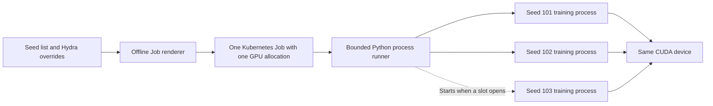

# Shared-GPU training implementation plan

Run several independent fits on one allocated NVIDIA GPU. Use a standard-library Python process runner inside one Kubernetes Job, with a MammaPrint adapter that generates the ordinary `ml.train` command for each seed. The reusable interface is a list of named commands and a maximum number of active processes.

The historical pilot example below uses ABMIL. For a launch example supported by `feat/tiling-values`, use the [shared-GPU training skill](../../../.agents/skills/shared-gpu-training/SKILL.md).

## Architecture



Each process retains its own Python state, CUDA context, RNG, Hydra configuration, and MLflow run. On standard CUDA, processes can be active concurrently while GPU work from separate contexts is time-sliced. This can overlap one run's CPU or I/O work with another run's GPU work. Throughput depends on how much of that work can overlap and whether the runs contend for other resources. NVIDIA MPS can enable cross-process kernel overlap and is a later benchmark option if the runtime supports it. [NVIDIA CUDA Best Practices Guide](https://docs.nvidia.com/cuda/cuda-c-best-practices-guide/index.html#multiple-contexts)

A Bash wrapper is enough for a two-fit demonstration. A Python runner makes the queue, shutdown, and retry behavior easier to implement and test. Cluster-managed GPU sharing would preserve one Kubernetes Job per seed and requires device-plugin configuration. The in-pod runner uses the repository's existing one-device allocation and gives explicit control over which fits share it. A MIG allocation is one CUDA device with its own capacity. Profile it separately before packing runs on it. [Kubernetes GPU scheduling](https://kubernetes.io/docs/tasks/manage-gpus/scheduling-gpus/) · [NVIDIA Kubernetes GPU sharing](https://docs.nvidia.com/datacenter/cloud-native/gpu-operator/24.3.0/gpu-sharing.html)

## 1. Build the process runner

**Files** `scripts/ml/run_training_batch.py` and `tests/test_run_training_batch.py`

- [ ] Define a version 1 JSON batch spec with `version`, `batch_id`, `max_parallel`, and ordered `runs`. Each run has an `id` and a literal `argv` list, for example `{"id":"seed-101","argv":["python","-m","ml.train","seed=101"]}`. Validate the entire spec before spawning. Require unique path-safe IDs, positive integer concurrency, and nonempty commands. Any future trainer can provide its command without importing MammaPrint training code.
- [ ] Expose `python -m scripts.ml.run_training_batch --spec SPEC --output-root ROOT --scratch-root SCRATCH --attempt-id ATTEMPT --execution-id EXECUTION [--dry-run]`. Start children with `subprocess.Popen` and no shell. Launch from the prepared source checkout, preserve the inherited device mask, and give children `TRAIN_BATCH_ID`, `TRAIN_RUN_ID`, `TRAIN_ATTEMPT_ID`, `TRAIN_EXECUTION_ID`, `TRAIN_RUN_DIR`, and a separate `TMPDIR` under the scratch root. A future trainer can read `TRAIN_RUN_DIR` or supply its own output flag. Fill each vacant slot until the queue is empty. A dry run validates and prints commands and paths without spawning processes or creating outputs.
- [ ] Use `<output-root>/<batch-id>/<attempt-id>/<execution-id>/<run-id>/` for each child's console log and durable files. Claim the execution directory exclusively, save the input spec, and atomically update a `status.json` snapshot on each transition. Include the run ID, log path, timestamps, state, and exit code. Record queued entries before spawning. An individual failure, including a spawn error, releases its slot and lets the remaining seeds run. Exit successfully only when every run succeeds.
- [ ] On `SIGTERM` or `SIGINT`, stop admitting work, signal each active process group, escalate to `SIGKILL` before the pod's grace period expires, and reap children. Persist interrupted and never-started entries as distinct states. An abrupt pod loss can leave stale states, so treat prior `running` entries as unresolved until checked.
- [ ] Test with CPU-only dummy commands. Prove two children overlap, the concurrency cap holds, a freed slot starts the next command immediately, and a failure still lets later work complete. Cover invalid specs, duplicate execution IDs, literal arguments with spaces or shell characters, output isolation, and termination of a child with a grandchild.

## 2. Add the MammaPrint adapter and render one GPU Job

**Files** `scripts/ml/render_training_batch_job.py` and `tests/test_render_training_batch_job.py`

- [ ] Expand the explicit `--seeds` list into one ordinary `uv run --no-sync python -m ml.train` command per seed. Accept one experiment and repeatable `--override` options. Keep adapter-owned settings for `seed`, `trainer.accelerator=gpu`, `trainer.devices=1`, run identity, and output paths. Reject conflicting overrides. Set `hydra.run.dir=${oc.env:TRAIN_RUN_DIR}`, `hydra.job.chdir=true`, and `++trainer.default_root_dir=${oc.env:TRAIN_RUN_DIR}` so the shared checkout stays the Hydra original working directory for Git provenance and each fit gets its own outputs. Use absolute paths for dataset and checkpoint inputs when required.
- [ ] Give each seed a readable `metadata.run_name` and MLflow tags `training_batch_id`, `training_run_id`, `training_attempt_id`, and `training_execution_id`. The first two identify the logical fit and the latter two identify its execution. Let `ml.train` create the MLflow run and call its existing seeding, fit, and checkpoint paths. Keep the experiment's fit and evaluation settings, including `test_after_fit`, unless the caller overrides them.
- [ ] Render a single-container `batch/v1` Job offline in the existing submission environment with `kube_jobs`. Reuse its GPU mapping and secure storage conventions. Use the checked-in ridge renderer as a reference for source pinning and explicit target metadata. Require the context, namespace, Job name, source commit, image, GPU type, CPU, memory, and shared-memory size. Default concurrency to `1` as the baseline. Request exactly one device regardless of seed count. Set `restartPolicy: Never`, `backoffLimit: 0`, and a termination grace period longer than runner shutdown. Pass the Pod UID with the Downward API as the execution ID and use the Job name as the attempt ID.
- [ ] Check out the published source commit and run `uv sync --frozen` once. Verify the pod sees exactly one CUDA device and record its GPU identity. Pass the batch spec as a JSON file in scratch and `exec` the runner so it receives pod termination signals. Preserve the existing tracking and training credential references. Keep credentials out of the spec and rendered output. Mount the approved data and projects volumes, give runs separate scratch directories, and write durable status and console logs to the configured projects path. Keep the renderer free of Kubernetes API calls.
- [ ] Test that offline rendering produces one Job and one GPU request, correctly selects full-GPU and MIG resources, and emits the same seed commands on repeated renders. Assert pinned source, storage, output and device settings, and safe handling of literal overrides. Compose the ABMIL mean and attention configs locally with `ml.train --cfg all --resolve`. Check distinct run names and paths, device count, and the intended evaluation flag.

Proposed render command for a three-seed validation-only example. The hardware choice and resource values are pilot inputs and should be checked against the selected workload and available allocation.

```bash
uv run --frozen python -m scripts.ml.render_training_batch_job \
  --context kubas-cluster --namespace rationai-jobs-ns \
  --job-name mammaprint-abmil-pack-pilot-a1 --batch-id abmil-pack-pilot \
  --source-commit "$TRAINING_SOURCE_COMMIT" --image cerit.io/rationai/base:2.0.6 \
  --gpu A40 --cpu 16 --memory 48Gi --shm 8Gi \
  --output-root /mnt/projects/mammaprint/training-batches \
  --experiment ml/train_mil_embeddings_abmil_mean_regression \
  --seeds 101 102 103 --max-parallel 2 --override test_after_fit=false \
  > training-batch-job.json
```

## 3. Verify on a representative workload and document the workflow

**Files** `.agents/skills/shared-gpu-training/SKILL.md` and the scripts and tests above

- [ ] Document local rendering, target checks, approval before each submission, expected artifacts, GPU and host monitoring, shutdown, and recovery. Have the Job name, GPU resource, seed list, pinned source, and output path visible in the reviewed manifest. Obtain explicit approval for each cluster submission after showing its context, namespace, and workload scope.
- [ ] On the same approved GPU model or MIG profile, compare the same frozen workload and seeds with concurrency `1` and `2`. Use an equal set of at least four development fits, with representative slides, batch size, precision, validation, and checkpoint writes. Include the largest likely batches in the memory check. Try `3` or `4` after the two-process pilot shows headroom. Verify distinct successful MLflow runs and checkpoints and verify the child execution intervals overlap on the one allocated device.
- [ ] Measure completed fits per allocated GPU-hour from pod startup through the last fit, plus each fit's runtime, combined peak device VRAM, host RAM, CPU, `/dev/shm`, local scratch, and time spent sourcing embeddings. Budget dataloader workers and numerical-library threads across children. Start with one fit's measured peak and allow about 20% initial VRAM headroom when screening concurrency. Use observed concurrent peak and throughput to select the cap. A reasonable initial promotion threshold is at least 20% more fits per GPU-hour, with no OOM or artifact errors. Record the cap by experiment family and GPU profile. Keep `1` for unprofiled combinations.
- [ ] Check dataset I/O before increasing the cap. The existing remote source helper downloads artifacts into a fresh temp directory per process, so seeds can multiply traffic and scratch usage. If that dominates the pilot, stage each needed split once into a pod-local directory, verify it before launching any fit, and use the loader's existing absolute local-directory support. Keep the original split URIs and local mapping in the batch provenance. Compare serial and parallel fits under the same staging policy. Add and document a reusable staging helper only if the measurements warrant it.
- [ ] Test partial failure and recovery. Inspect the durable per-run state and MLflow tags together after the prior Job has finished. Render a new attempt containing only explicitly selected failed or never-started seed IDs. Reconcile interrupted or ambiguous entries with MLflow and checkpoint evidence before retrying. Keep the original batch ID and retain attempt histories. A whole-Job replay would duplicate successful fits, so keep packed jobs outside the existing generic retry script's name prefixes.
- [ ] Run the focused runner and renderer tests locally and independently review the changes before cluster use. The existing sweep can adopt packing later by grouping compatible seeds after resource selection and counting each packed Job as one queue slot. It can reuse the runner with no change to the command manifest contract.
